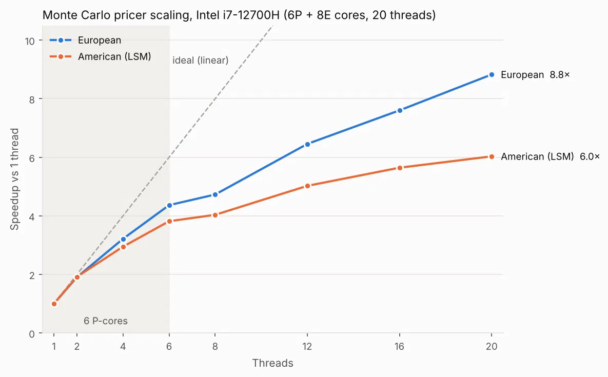

# Parallel Monte Carlo Option Pricer (C++20)

Pricing **European** and **American** options with Monte Carlo simulation, serial and multithreaded
(`std::thread` + `std::barrier`). American options use the **Longstaff-Schwartz** least-squares
Monte Carlo algorithm (LSM, 2001). Every result is validated against a closed-form or published
reference, and the parallel versions return **exactly the same price** as the serial ones.

| | |
|---|---|
| Language | C++20 |
| Parallelism | `std::thread`, `std::barrier`, per-thread accumulators (no OpenMP) |
| RNG | Philox4x32 counter-based generator ([Random123](https://github.com/DEShawResearch/random123)) |
| Linear algebra | Eigen (3×3 normal equations, LDLᵀ) |
| Testing | GoogleTest |
| Benchmarks | Google Benchmark |
| Build | CMake + Conan 2, GitHub Actions CI |

---

## Results

Reference parameters (from Longstaff & Schwartz, 2001): `S0 = 36, K = 40, r = 6%, σ = 20%, T = 1 year`.

| Option | Method | Price | Reference |
|---|---|---|---|
| European call | Black-Scholes (closed form) | 2.1737 | — |
| European put | Black-Scholes (closed form) | 3.8443 | — |
| European call | Monte Carlo | 2.17 ± 3σ | Black-Scholes |
| European put | Monte Carlo | 3.84 ± 3σ | Black-Scholes |
| American put | LSM, 100 000 paths × 50 steps | ≈ 4.48 | 4.478 (paper) |
| American call | LSM | ≈ 2.17 | = European call (no dividends) |

The American put is worth more than the European one (4.48 vs 3.84): the difference is the value of the
right to exercise early. The American call on a non-dividend stock is never exercised early, so it
equals the European call, which is a useful sanity check.

---

## How it works

### 1. Simulating the stock price

The stock follows a geometric Brownian motion under the risk-neutral measure. One time step:

```
S(t + dt) = S(t) · exp( (r − σ²/2)·dt  +  σ·√dt · Z ),    Z ~ N(0, 1)
```

The option price is the **average payoff, discounted to today**:

```
price = e^(−r·T) · mean( max(K − S_T, 0) )          (put)
error = e^(−r·T) · stddev(payoff) / √N               (standard error)
```

`e^(−r·T)` converts money received at expiry into money today (continuous compounding).

### 2. Reproducible random numbers

Each normal draw is a pure function of `(seed, path, step)`:

```cpp
Philox4x32  counter = {path, step, 0, 0},  key = {seed, 0}
u1, u2 = uniform(output[0]), uniform(output[1])
Z = sqrt(−2·ln u1) · cos(2π·u2)          // Box-Muller
```

Since there is no generator state shared between threads, **path 7 at step 12 always gets the same
number no matter which thread simulates it or how many threads there are**. That is why the
parallel result equals the serial result to the last bits.

### 3. American options: Longstaff-Schwartz

On every day the holder chooses between:

- **exercise now** → get `K − S` (known), or
- **continue** → get the *expected* value of holding (unknown, depends on the future).

LSM estimates the continuation value with a regression and works **backwards in time**, like
dynamic programming:

1. Simulate all paths forward and store them (`S[step * N + path]`).
2. At expiry: `cash[path] = payoff(S_T)`.
3. For each step from `T − dt` back to `dt`:
   1. `cash *= e^(−r·dt)`: bring future cash one step back.
   2. Keep only the **in-the-money** paths (`payoff(S) > 0`).
   3. Regress the discounted cash on `{1, x, x²}` with `x = S / K`.
      The fitted parabola is the estimated continuation value.
   4. Where `payoff(S) > continuation(S)`, exercise: `cash[path] = payoff(S)`.
4. `price = max( e^(−r·dt) · mean(cash), payoff(S0) )`.

**The regression only decides *when* to exercise; the realized cash flows decide *how much*.**
Using an approximate exercise rule can never beat the optimal one, so LSM is biased slightly low,
which is why the tests allow a small margin under 4.478.

#### Worked example (8 paths, from the paper)

`S0 = 1.00, K = 1.10, r = 6%`, three exercise dates. At `t = 2` the in-the-money paths give:

| path | S(t=2) | exercise now | continuation (fit) | decision |
|---|---|---|---|---|
| 1 | 1.08 | 0.02 | 0.0367 | continue |
| 3 | 1.07 | 0.03 | 0.0459 | continue |
| 4 | 0.97 | 0.13 | 0.1175 | **exercise** |
| 6 | 0.77 | 0.33 | 0.1520 | **exercise** |
| 7 | 0.84 | 0.26 | 0.1564 | **exercise** |

Repeating at `t = 1` and averaging gives **0.1144**, versus **0.0564** for the European put on the
same paths.

#### The regression is just sums

Least squares on the basis `{1, x, x²}` reduces to the 3×3 normal equations:

```
| Σ1   Σx   Σx²  |   | b0 |   | ΣY    |
| Σx   Σx²  Σx³  | · | b1 | = | ΣxY   |
| Σx²  Σx³  Σx⁴  |   | b2 |   | Σx²Y  |
```

The system is always 3×3, whatever the number of paths. All the work is in the sums, and sums
split naturally across threads.

Two numerical details:

- **`x = S / K` instead of `S`**: it gives the same parabola mathematically, but with `S ≈ 36` the
  matrix entries range from 1 to 36⁴ ≈ 1.7·10⁶. The condition number drops from **2.7·10⁹ to 4.4·10⁴**
  when scaling. The payoff is always computed on the real `S`.
- **At least 3 in-the-money paths are required** (`Σ1 ≥ 3`): a parabola has 3 unknowns. With fewer
  points the system is singular, so the step is skipped (nobody exercises).

---

## Parallelization

### European

Paths are independent. Each thread simulates a contiguous block of paths and keeps its own
`sum` and `sum_sq` in **local variables**, written to the shared array once at the end. Then the
main thread adds the partial sums.

### American

The forward simulation is embarrassingly parallel. The backward pass needs all threads to agree on
one regression per step:

```
for each step (backwards):
    each thread: discount its cash, accumulate local XᵀX and XᵀY over its paths
    ── barrier ──
    thread 0:    sum the per-thread matrices, solve the 3×3 system
    ── barrier ──
    each thread: exercise decisions on its own paths with the shared coefficients
```

Only **9 + 3 numbers per thread per step** are shared, so the synchronization cost is tiny compared
to the work on the paths.

### False sharing

The first parallel version accumulated directly into `std::vector<double>` slots indexed by thread.
Neighbouring slots live on the same 64-byte cache line, so every write invalidates the line in the
other cores' caches.

| Version (2 threads, i7-12700H) | Time |
|---|---|
| accumulate directly in shared vector | 1561 ms |
| accumulate in local variables, write once | **122 ms** |

**12.8× faster** from moving the accumulators into local variables (the fix is local accumulators,
or `alignas(64)` padding).

---

## Benchmarks

Machine: Intel i7-12700H (6 P-cores with hyper-threading + 8 E-cores, 20 threads), Linux, GCC, `-O3`.




**European, 1 000 000 paths**

| Threads | Time (ms) | Speedup |
|---|---|---|
| 1 | 14519 | 1.0× |
| 2 | 7619 | 1.91× |
| 4 | 4516 | 3.21× |
| 6 | 3326 | 4.37× |
| 8 | 3071 | 4.73× |
| 12 | 2249 | 6.46× |
| 16 | 1910 | 7.60× |
| 20 | 1645 | **8.83×** |

**American (LSM), 1 000 000 paths × 365 steps**

| Threads | Time (ms) | Speedup |
|---|---|---|
| 1 | 20549 | 1.0× |
| 2 | 10709 | 1.92× |
| 4 | 6973 | 2.95× |
| 6 | 5385 | 3.82× |
| 8 | 5093 | 4.03× |
| 12 | 4090 | 5.02× |
| 16 | 3641 | 5.64× |
| 20 | 3407 | **6.03×** |

**Observations**

- **Up to 6 threads** scaling is close to linear: every thread gets its own performance core.
- **From 6 to 8 threads the curve flattens** (European 4.37× → 4.73×, American 3.82× → 4.03×).
  Threads 7 and 8 land on the slower efficiency cores. With **static** partitioning (equal blocks of
  paths) every thread gets the same amount of work, so the slowest thread decides the total time.
- **From 8 to 20 threads** the speedup grows again, but more slowly: the extra threads come from
  hyper-threading (two threads sharing one P-core) and the remaining E-cores.
- **The American pricer scales worse** (6.0× vs 8.8×):
  - each of the 365 steps has barriers, and thread 0 solves the regression alone while the others wait;
  - the path matrix (1M × 365 doubles ≈ 2.9 GB) is streamed from memory on every backward step, so
    memory bandwidth becomes a limit, not just the cores.

---

## Testing

| Test | Checked against | Tolerance |
|---|---|---|
| `BlackScholes.Call / Put` | known values 2.1737 / 3.8443 | 1e-4 |
| `European.Call / Put` | Black-Scholes | 3 standard errors |
| `American.Put` | 4.478 (Longstaff & Schwartz) | 3 standard errors + 0.02 (LSM bias) |
| `American.Put` | > European put, ≥ `K − S0` | — |
| `American.Call` | Black-Scholes call | 3 standard errors + 0.01 |
| `*Threads*` | serial version, same seed | 1e-10 (exact up to summation order) |

The parallel code was also checked with **ThreadSanitizer** (`-fsanitize=thread`).

---

## Build

Requirements: GCC 11+ or Clang 14+, CMake ≥ 3.23, Conan 2 (`pipx install conan`).

```bash
git clone --recursive <repo-url>          # --recursive pulls Random123 (submodule)
cd monte_carlo_simulation

conan profile detect
conan install . --build=missing -s compiler.cppstd=20
cmake --preset conan-release
cmake --build --preset conan-release

./build/Release/mc                        # run the pricer
ctest --preset conan-release              # run the tests
./build/Release/mc_bench                  # run the benchmarks
```

## Project structure

```
include/        Params, Result, payoff, Philox normal generator, function declarations
src/
  europe.cpp          European Monte Carlo (serial + threads)
  america.cpp         Longstaff-Schwartz (serial + threads with std::barrier)
  black_scholes.cpp   closed-form reference prices
  main.cpp
tests/          GoogleTest
benchmarks/     Google Benchmark
random123/      Random123 (git submodule, header-only)
scripts/        plot_speedup.py (generates docs/speedup.png)
docs/           images for this README
conanfile.txt   GoogleTest, Google Benchmark, Eigen
.github/        CI: build + tests on every push
```

---

## Roadmap

- [x] European call / put, serial + threads, validated against Black-Scholes
- [x] American call / put with Longstaff-Schwartz, serial + threads
- [x] Reproducible counter-based RNG (parallel == serial)
- [x] GoogleTest, Google Benchmark, CI
- [ ] Greeks: Delta, Gamma, Vega, Rho (bump-and-reprice with common random numbers vs closed form)
- [ ] Command-line interface (CLI11)
- [x] Speedup plots
- [ ] Optimization study: mutex vs atomic vs local accumulators, static vs dynamic scheduling on a
      hybrid CPU, memory layout of the path matrix

### Other parallel back ends, compared against the `std::thread` version

- [ ] **OpenMP**: `#pragma omp parallel for reduction(+:sum)` for the European pricer, and
      `omp barrier` / `omp single` for the LSM regression step. The goal is to compare a few pragmas
      with the hand-written threads and barriers on both speed and code size.
- [ ] **Custom thread pool with C++20 coroutines**: a fixed pool of worker threads and a task queue;
      work is split into chunks of paths that are `co_await`ed, and `when_all` replaces the barrier.
      Small chunks give **dynamic load balancing**, which should fix the plateau between 6 and 8
      threads on the hybrid P/E-core CPU.
- [ ] **CUDA**: one GPU thread per path. Philox needs no state, so every thread generates its own
      numbers from `(seed, path, step)`, the same as on the CPU. The regression sums become a
      parallel reduction on the GPU, and the 3×3 system is still solved on the CPU.
      The result can be checked against the CPU price with the same seed.
- [ ] **MPI**: paths split across machines, `MPI_Allreduce` on the 12 regression sums per step.

## References

- F. Longstaff, E. Schwartz, *Valuing American Options by Simulation: A Simple Least-Squares
  Approach*, Review of Financial Studies 14(1), 2001.
- J. Salmon, M. Moraes, R. Dror, D. Shaw, *Parallel Random Numbers: As Easy as 1, 2, 3*, SC 2011.
- P. Glasserman, *Monte Carlo Methods in Financial Engineering*, Springer, 2003.
